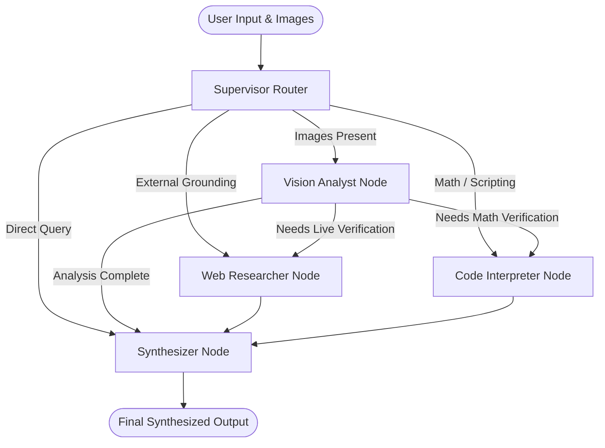

# 🌐 OmniAgent: Production Multi-Modal Multi-Agent System (LangGraph)

[](https://www.python.org/)
[](https://github.com/langchain-ai/langgraph)
[](https://github.com/langchain-ai/langchain)
[](https://streamlit.io/)
[](https://fastapi.tiangolo.com/)
[](https://opensource.org/licenses/MIT)

> **Autonomous multi-modal orchestration engine capable of visual reasoning, algorithmic code execution, dynamic web grounding, and stateful memory across sessions.**

---

## 📌 Resume Showcase Summary

> **Copy & paste into your resume under Experience / Projects:**
> 
> **OmniAgent: Multi-Modal Multi-Agent System with LangGraph** *(Python, LangGraph, FastAPI, Streamlit, Groq, OpenAI)*
> - Engineered a cyclical multi-agent system using **LangGraph StateGraph** featuring a **Supervisor Router** coordinating specialized subagents for **Vision Analysis**, **Live Web Research**, and **Python Code Execution**.
> - Architected multimodal perception pipelines handling charts, system architectures, and error screenshots using **Llama 3.2 Vision** and **GPT-4o** with dynamic base64 optimization and dimension scaling.
> - Implemented stateful conversational persistence with **LangGraph MemorySaver checkpointer**, enabling thread-level session resumption, intermediate thought tracing, and latency monitoring.
> - Developed dual delivery interfaces: a production **FastAPI REST API** with CORS middleware and an interactive **Streamlit Dashboard** featuring 1-click test galleries and live execution step traces.
> - Built resilient tool integrations including dual web grounding (Tavily API with automatic DuckDuckGo fallback) and a sandboxed Python REPL with restricted globals.

---

## 🎯 Key Highlights

- **🧠 Cyclical LangGraph Architecture**: Fully compiled state graph with deterministic conditional edges, explicit typed state (`AgentState`), and custom reducers (`merge_dicts`, `append_list`, `add_messages`).
- **👁️ Multimodal Visual Reasoning**: Deep inspection of financial charts, cloud architecture diagrams, UI bug screenshots, and documents.
- **⚡ Dual-Engine Web Grounding**: Real-time factual retrieval via Tavily API with automatic, zero-credential DuckDuckGo fallback.
- **💻 Sandboxed Python REPL**: Dynamic computation engine for running mathematical checks, CAGR calculations, or statistical transformations with stdout capture.
- **🔌 Multi-Provider Support**: Pluggable backend supporting **Groq** (`llama-3.2-11b-vision`, `llama-3.3-70b`), **OpenAI** (`gpt-4o`, `gpt-4o-mini`), and a built-in **Offline Mock Mode** that runs with 0 API keys.
- **🖥️ Interactive Frontend Dashboard**: Glassmorphic Streamlit web app with 1-click sample galleries, live node trace visualizer, tool execution inspect pane, and JSON session export.
- **🚀 Production REST API**: FastAPI server exposing endpoints for chatting, retrieving graph architecture diagrams, and inspecting thread history.

---

## 🏗️ Architecture & Agent Topology



For a comprehensive deep dive into the state schema, memory reducers, and security boundaries, read [ARCHITECTURE.md](ARCHITECTURE.md).

---

## ⚡ Quickstart Guide

### 1. Clone & Set Up Virtual Environment

```bash
# Clone the repository
git clone https://github.com/your-username/Multi_Modal_agent-langrapgh.git
cd Multi_Modal_agent-langrapgh

# Create and activate virtual environment
python -m venv venv
# Windows:
.\venv\Scripts\activate
# Linux / macOS:
source venv/bin/activate

# Install dependencies
pip install -r requirements.txt
```

### 2. Configure Environment Variables (Optional)

Copy `.env.example` to `.env`:

```bash
cp .env.example .env
```

```env
DEFAULT_LLM_PROVIDER=groq
GROQ_API_KEY=your_groq_api_key_here
OPENAI_API_KEY=your_openai_api_key_here
TAVILY_API_KEY=your_tavily_api_key_here
```

*(Note: If no API keys are provided, the system automatically falls back to the **Built-in Mock / Offline Demo Mode**, so you can test all features immediately!)*

---

## 🚀 Running the Project

### Option A: Interactive Streamlit Web UI (Recommended)

```bash
python run.py --ui
```
*Launches the modern web dashboard at `http://localhost:8501`.*

### Option B: FastAPI Backend Server

```bash
python run.py --api
```
*Starts the API server at `http://127.0.0.1:8000` with interactive Swagger docs at `http://127.0.0.1:8000/docs`.*

### Option C: Terminal CLI

```bash
python run.py --cli
```

---

## 🧪 Testing & Verification

Run the full automated test suite covering state reducers, multimodal image encoding, Python REPL sandbox, search fallbacks, and LangGraph workflow streaming:

```bash
pytest -v
```

---

## 📂 Project Structure

```
Multi_Modal_agent-langrapgh/
├── src/
│   ├── agent/
│   │   ├── nodes/
│   │   │   ├── supervisor.py       # Intent classification & routing node
│   │   │   ├── vision.py           # Multimodal visual perception node
│   │   │   ├── researcher.py       # Live web search & grounding node
│   │   │   ├── code_executor.py    # Sandboxed Python calculation node
│   │   │   └── synthesizer.py      # Artifact aggregation & answer generator
│   │   ├── tools/
│   │   │   ├── image_utils.py      # Base64 encoding, resizing, EXIF handling
│   │   │   ├── python_repl.py      # Safe Python REPL with namespace isolation
│   │   │   └── web_search.py       # Tavily + DuckDuckGo fallback tool
│   │   ├── graph.py                # LangGraph StateGraph assembly & edges
│   │   └── state.py                # AgentState schema with functional reducers
│   ├── api/
│   │   └── server.py               # FastAPI REST endpoints & CORS middleware
│   ├── config.py                   # Pydantic Settings configuration
│   ├── llm_factory.py              # Provider switcher (Groq, OpenAI, Mock)
│   ├── cli.py                      # Interactive terminal interface
│   └── generate_samples.py         # Synthetic demo assets generator
├── frontend/
│   ├── app.py                      # Streamlit interactive UI application
│   ├── style.css                   # Modern dark-theme glassmorphism styling
│   └── sample_images/              # Preloaded demo images for 1-click tests
├── tests/
│   ├── test_graph.py               # LangGraph workflow & streaming tests
│   ├── test_state.py               # State reducer unit tests
│   └── test_tools.py               # Tool execution & image helper tests
├── run.py                          # Unified CLI / UI / API runner
├── requirements.txt                # Pinned production dependencies
├── ARCHITECTURE.md                 # Deep architectural documentation
└── README.md                       # Main project documentation & resume summary
```

---

## 📜 License

Distributed under the MIT License. See `LICENSE` for more information.

